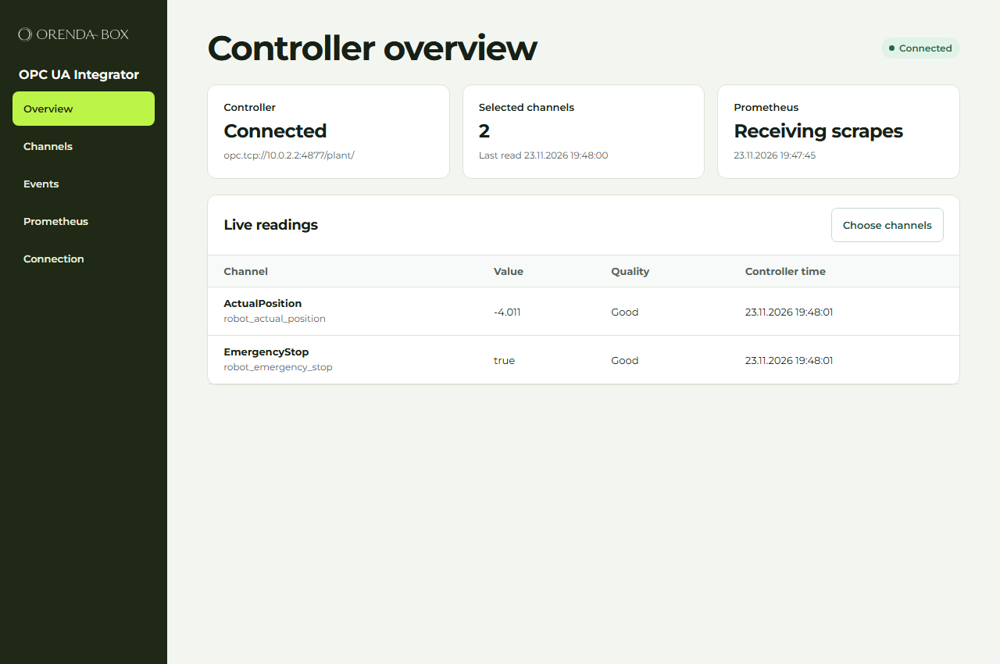

# OPC UA Integrator for OrendaBox

Connect a read-only OPC UA observer to a controller, choose the channels to collect, and query their values in Prometheus. The app uses Edge Console identities. Administrators configure the connection and channels. Operators can view readings, events and output health.



## Connect your first controller

1. Install the ARM64 app through Orenda Apps and grant **Outbound network access** so the Box can reach the controller.
2. Open **Connection**, enter the full address (for example, `opc.tcp://controller:4840/`), then select **Discover endpoint**. Compare the displayed SHA-256 fingerprint with the controller's certificate.
3. Choose an identity offered by the server. For a server that requires client trust, download the Box public certificate from the same screen and import it into the controller's trusted client list. Select **Trust and connect**.
4. Open **Channels** and browse to a variable, or inspect a known NodeId. Check its current value, quality and controller time. Choose a metric suffix including its unit when appropriate, such as `axis_a1_degrees`, then **Add channel**.
5. Configure the collector once using the [Box Prometheus setup](docs/prometheus.md). **Overview** shows when the collector last scraped the app. The **Prometheus** preview displays the output independently.
6. To receive faults, browse to a controller object, **Inspect**, and choose **Listen for events here**. **Events** shows the last 200 messages received in this app process, with controller and Box times, code, text, severity and retained flag. Servers supporting condition refresh can replay retained conditions when a subscription starts.

## Controller compatibility

The client selects a Sign & Encrypt endpoint with AES256-SHA256-RSA-PSS, AES128-SHA256-RSA-OAEP or Basic256Sha256. It supports username/password and anonymous user identity tokens. It pins the server certificate, maintains its own client identity across restarts, and uses the discovered server application URI even when a controller advertises a different hostname. A certificate change needs administrator confirmation.

The first release supports one server, one event source and 128 selected numeric or Boolean scalar channels per installation. The default bulk read interval is 2 seconds, adjustable from 1 to 60. Metric suffixes are stable configuration names. Namespace URIs identify selected nodes across controller restarts. Strings can be previewed. Arrays, structures, non-finite values and integers outside the exact double-precision range are omitted from value metrics. A failed read reports channel quality. OPC UA event text remains in the event view. The app makes observation calls and has no robot motion, variable-write or alarm-acknowledgement controls.

On KUKA DeviceConnector, browse through **DeviceSet → MotionDeviceSystem → MotionDevices → Robot → Axes → A1 → ParameterSet → ActualPosition**. Repeat for other axes. The controller object under **Controllers** can expose KSS events. Check DeviceConnector options and the observer's node permissions if browse works but a value returns BadUserAccessDenied. The app packages no factory account or customer configuration.

## Data and access

Edge controls the network grant and signs in users through the app-specific proxy. The certificate key, controller credentials and selections live in the app-owned persistent volume in a mode-0600 file. Treat volume backups as credentials. A distinct read-only bearer credential authorizes TCP scrapes. The bundled Box collector can use a dedicated local scrape socket. Installing the market app leaves host Prometheus configuration with the Box administrator.

## Offline development

Use Python 3.10–3.12. From the repository root install the pinned dependencies in a virtual environment, then run:

```sh
python -m pip install -r requirements.txt
python -m unittest tests.test_integration
python -m tools.demo
```

Open the loopback URL printed by the simulator. Select **Anonymous** and browse its **Robot** object. For repeatable browser qualification, start a fresh simulator, install Playwright and Chromium in the test environment, and run `python -m tools.qualify_browser`. Set `PROMETHEUS_BIN` to the path of a Prometheus executable to include a real scrape and TSDB query. Test and development servers are excluded from the production image.

See the [research and pre-implementation UX plan](docs/design.md), [Prometheus integration](docs/prometheus.md), [release qualification](docs/release.md) and [ARM64 workflow](.github/workflows/qualify.yml).
